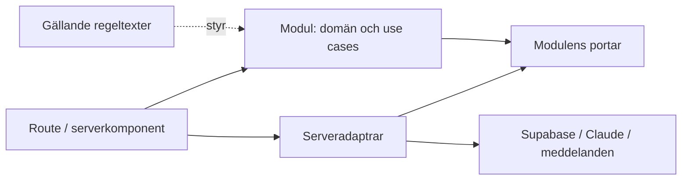

# Arkitektur

En modulär monolit gör att en agent kan arbeta inom ett område med kort kontext,
medan appen kan byggas och släppas som en enhet. Next.js kör både gränssnitt och
server på Vercel. Supabase och Claude ansluts via serveradaptrar. Beslutade
teknikregler finns i [rules/system.txt](../rules/system.txt).

```text
apps/web/
  src/app/              kund-/adminroutes och sammansättning
  src/modules/          verksamhetsområden
    catalog/            fakta, produkter, priser, ingredienser
    ordering/           utkast, godkännande, order, förfrågan, betalningsstatus
    availability/       kalender, tider, kapacitet, reservation
    conversation/       dialogtillstånd och tillåtna verktygsåtgärder
    staff/              personalens behöriga arbetsflöden
    access/             identitet och behörighetskontroller
    business-hours/     redigerbara öppettider och publicering
  src/server/           adaptrar: Claude, Supabase, Google, meddelanden
  src/shared/           gemensam presentation och tekniska smådelar
  public/               publika statiska filer
supabase/               konfiguration, migrationer och databasprov
rules/                  facit med uttrycklig status och stabila ID:n
docs/                   förklaringar, historik och driftinstruktioner
tooling/                ändringsklassificering och releaseverktyg
tests/e2e/              hela kund- och personalflöden
evals/                  modellberoende dialog- och verktygsscenarier
```

Områdeskatalogerna börjar med en kort ansvarstext. Skapa `domain/`,
`application/`, publikt `index.ts` och `ui/` när respektive funktion införs.
Se [modulinstruktionerna](../apps/web/src/modules/AGENTS.md). Separata paket,
mikrotjänster och en uppgiftsorkestrerare behövs inte för den här grunden.



Domänlogik är deterministisk och testbar utan nätverk. Use cases använder portar
för exempelvis orderlagring och klocka. Serveradaptrar implementerar portarna.
Routes sätter samman delarna och översätter HTTP till use case-anrop. Funktionens
UI ligger nära sin modul. Next.js-specifika filer stannar i `app/`.

Claude får ett avgränsat verktygsgränssnitt till use cases. En framtida ändring
av modell eller prompt ska kunna göras utan att skriva om order- eller prislogik.
För godkännande, reservation och betalning behöver kommande implementation ha
tydligt tillstånd och atomära kontroller; detaljerna i det gamla repot är förslag.

Regeltexterna är verifieringsunderlaget. Beslut skrivs i rätt textfil före kod,
och relevanta tester märks med regel-ID. Programmet behöver strukturerad data
och exekverbara kontroller; dessa granskas mot texten. Vi försöker inte tolka
godtycklig regelprosa till körbar kod. En driftprompt får endast behandla
GÄLLANDE regler som krav.

ESLint skyddar domänlagret mot de vanligaste ramverks-/SDK-importerna. Det är
ett stöd; relativa importer och alla beroenderiktningar verifieras fortfarande
vid granskning. Utöka maskinkontrollerna när verkliga moduler finns.

Grundstrukturen har inga affärsfunktioner, tabeller eller anslutna integrationer.
Administrationen och Google-integrationen är beslutade nya funktioner i
[access.txt](../rules/runtime/access.txt) och
[business-hours.txt](../rules/runtime/business-hours.txt). Val av login/kod,
detaljerad behörighetsmatris och synkriktning är ännu öppna.

Tidsmodulen ska hålla öppettider och beställningsfönster för samma dag åtskilda. Varje
tidstyp har standardvecka och datumundantag. En gemensam beräkning av effektiva
tider per datum används av veckovyn och andra konsumenter, så att undantag inte
tolkas olika i UI, orderkontroll och Google-publicering. Veckovyn visar
innevarande vecka och markerar verkliga skillnader mot standardveckan.
Hämtning följer samma schema som öppettiderna. Beställningsfönstret styr när
sammadagsbeställningar tas emot; utanför fönstret används förbeställningsflödet.
Scheman och undantag lagras som redigerbara driftdata; de ändras utan deployment.
Regelförslag och öppna frågor ligger i `rules/proposals/` och påverkar inte
deployment. `rules/runtime/` innehåller endast beslutade verksamhetsregler.

Nästa steg är att besluta en liten sammanhängande del av reglerna, exempelvis
produktval och prissättning, och implementera den genom alla relevanta lager.
