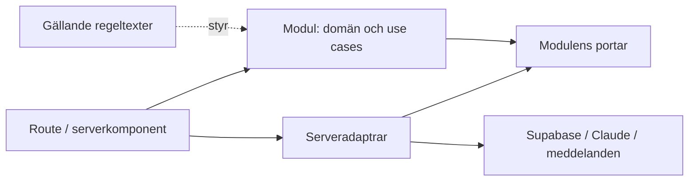

# Arkitektur

En modulär monolit gör att en agent kan arbeta inom ett område med kort kontext,
medan appen kan byggas och släppas som en enhet. Next.js kör både gränssnitt och
server på Vercel. Supabase och Claude ansluts via serveradaptrar. Beslutade
teknikregler finns i [rules/system.txt](../rules/system.txt).

```text
apps/web/
  src/app/              kund-/adminroutes och sammansättning
  src/modules/          verksamhetsområden
    catalog/            fakta, produkter, priser, ingredienser
    ordering/           utkast, godkännande, order, förfrågan, betalningsstatus
    availability/       kalender, tider, kapacitet, reservation
    conversation/       dialogtillstånd och tillåtna verktygsåtgärder
    staff/              personalens behöriga arbetsflöden
    access/             identitet och behörighetskontroller
    business-hours/     tidsdomän, kundvisning och lokal adminförhandsvisning
  src/server/           adaptrar: Claude, Supabase, Google, meddelanden
  src/shared/           gemensam presentation och tekniska smådelar
  public/               publika statiska filer
supabase/               konfiguration, migrationer och databasprov
rules/                  facit med uttrycklig status och stabila ID:n
docs/                   förklaringar, historik och driftinstruktioner
tooling/                ändringsklassificering och releaseverktyg
tests/e2e/              hela kund- och personalflöden
tests/security/         serveradapterns sessionskontroller
evals/                  modellberoende dialog- och verktygsscenarier
```

Områdeskatalogerna börjar med en kort ansvarstext i `AGENTS.md`. Skapa `domain/`,
`application/`, publikt `index.ts` och `ui/` när respektive funktion införs.
Se [modulinstruktionerna](../apps/web/src/modules/AGENTS.md). Separata paket,
mikrotjänster och en uppgiftsorkestrerare behövs inte för den här grunden.

Kod och dokumentation är organiserade för agentarbete enligt SYS-013:

- `AGENTS.md` innehåller korta arbetsinstruktioner för sitt underträd och pekar
  ut relevant regelunderlag. Instruktioner som behövs vid kodändring ligger här.
- Codex och uppdaterad Claude Code delar dessa `AGENTS.md`-filer. Vi underhåller
  inga parallella `CLAUDE.md`-kopior eller importfiler för äldre verktygsversioner.
- Rotens `README.md` är en kort ingång. Längre arkitektur- och driftförklaringar
  ligger i `docs/` och läses vid behov. Verksamhetsregler hålls samlade i `rules/`.

Codex upptäcker instruktioner längs vägen från projektroten till arbetskatalogen;
det innebär inte att alla agentfiler längre ned redan finns i kontexten.
Rotinstruktionen kräver därför läsning längs sökvägen till filerna som ska ändras.
Claude Code läser också lokala `AGENTS.md` när den arbetar i underkataloger.
Direkt AGENTS.md-stöd finns från 2.1.277 i standardkonfiguration; använd en
uppdaterad version. Om en överordnad `CLAUDE.md` eller `CLAUDE.local.md` finns,
kontrollera att Claudes inställning för Project instructions även läser AGENTS.md.
Kontrollera inlästa filer med `/context`. Repoändringen ändrar inga personliga
verktygsinställningar.

Lägg en ny lokal `AGENTS.md` när området behöver egen vägledning. Håll den kort
och hänvisa till reglerna i stället för att kopiera dem. Instruktionsfilerna är
undantagna från deploymentklassificeringen.

Laddningsbeteende: [OpenAI Docs om AGENTS.md](https://learn.chatgpt.com/docs/agent-configuration/agents-md)
och [Claude Code om AGENTS.md](https://code.claude.com/docs/en/memory#agentsmd).



Domänlogik är deterministisk och testbar utan nätverk. Use cases använder portar
för exempelvis orderlagring och klocka. Serveradaptrar implementerar portarna.
Routes sätter samman delarna och översätter HTTP till use case-anrop. Funktionens
UI ligger nära sin modul. Next.js-specifika filer stannar i `app/`.

Claude får ett avgränsat verktygsgränssnitt till use cases. En framtida ändring
av modell eller prompt ska kunna göras utan att skriva om order- eller prislogik.
För godkännande, reservation och betalning behöver kommande implementation ha
tydligt tillstånd och atomära kontroller; detaljerna i det gamla repot är förslag.

Regeltexterna är verifieringsunderlaget. Beslut skrivs i rätt textfil före kod,
och relevanta tester märks med regel-ID. Programmet behöver strukturerad data
och exekverbara kontroller; dessa granskas mot texten. Vi försöker inte tolka
godtycklig regelprosa till körbar kod. En driftprompt får endast behandla
GÄLLANDE regler som krav.

ESLint skyddar domänlagret mot de vanligaste ramverks-/SDK-importerna. Det är
ett stöd; relativa importer och alla beroenderiktningar verifieras fortfarande
vid granskning. Utöka maskinkontrollerna när verkliga moduler finns.

Den provbara appen kombinerar meny och Claude-chatt enligt
[UX-reglerna](../rules/runtime/ordering-experience.txt) och
[chattreglerna](../rules/runtime/conversation.txt). `catalog/` äger meny och
fakta, `ordering/` äger samma strukturerade varukorg och lokala demohistorik,
`conversation/` äger dialog och validerade ändringsförslag. `server/claude/`
anropar Messages API. `/api/chat` kopplar kontextvalidering och adaptern.
Utan Claude används en uttryckligt begränsad fallback; den ersätter inte fri dialog.

Modellverktyg får föreslå tillägg, ersättning, borttagning, granskning och avbokning.
De utför inga mutationer. Förslag binds till varukorgens innehåll vid anropet och
blir ogiltiga om kunden ändrar sina val innan godkännande. Varukorgsfrågor besvaras
med kodens samtliga aktuella rader och total, inte modellens minne. Sparad demo
har oföränderlig prisögonblicksbild och referens. `localStorage` synkar flikar och
rapporterar fel; det ersätter inte behörig serveråtkomst till riktiga ordrar.

Sidhuvudets öppettider och beställningsvyernas egna tidsrader använder samma
demostandardvecka enligt OPPEN-016–017; samma fakta är tillgängliga för Claude.
Beställningstider ingår inte i det gemensamma huvudet. När kunden börjat chatta
krymper mobilhuvudet och introduktionen döljs så att samtalet får mer utrymme.
Tidsraderna visar inte kapacitet.

Administrationen och Google-integrationen är beslutade nya funktioner i
[access.txt](../rules/runtime/access.txt) och
[business-hours.txt](../rules/runtime/business-hours.txt). `/admin` använder
serververifierad superadmin-kod enligt BEH-005. `server/access/` signerar och
validerar sessionscookies, `/api/admin/session` hanterar login och logout.
Personliga konton, detaljerad behörighetsmatris och Googles synkriktning är öppna.

Tidsmodulen ska hålla öppettider och beställningsfönster för samma dag åtskilda. Varje
tidstyp har standardvecka och datumundantag. En gemensam beräkning av effektiva
tider per datum används av veckovyn och andra konsumenter, så att undantag inte
tolkas olika i UI, orderkontroll och Google-publicering. Veckovyn visar
innevarande vecka och markerar verkliga skillnader mot standardveckan.
Hämtning följer samma schema som öppettiderna. Beställningsfönstret styr när
sammadagsbeställningar tas emot; utanför fönstret används förbeställningsflödet.
Scheman och undantag lagras som redigerbara driftdata; de ändras utan deployment.
Första adminversionens avgränsning finns i runtime/administration.txt: tidsdomänen
och redigeringen finns, men schemat sparas endast som lokal förhandsvisning.
Det påverkar ännu inte kunder eller Google. Supabase-lagring ska senare ersätta
previewlagringen via en servergräns som kontrollerar behörighet vid varje anrop.
Regelförslag och öppna frågor ligger i `rules/proposals/` och påverkar inte
deployment. `rules/runtime/` innehåller endast beslutade verksamhetsregler.

Nyare ändringar i det äldre repot vid 1ef53f5 finns som separat
[underlag](../rules/proposals/legacy-update-2026-10-22.txt). Produkt- och tillverkningsfakta har därefter godkänts i runtime/catalog.txt.
Betalnings-, tids- och kapacitetsregler blir inte bindande enbart genom demomenyn.

Nästa funktionella del är serverägt beställningsutkast och säker Supabase-orderlagring.
Därefter kopplas regler för hämtning, orderregistrering och betalning.
Kundavbokning före betalning är beslutad i ORD-016; efter betalning kontaktas personalen. Röstanvändning är en senare inmatningsväg till samma beställningsmodell.
